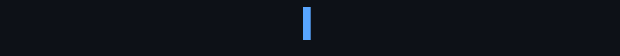
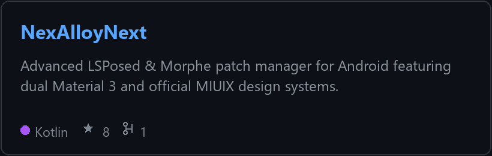
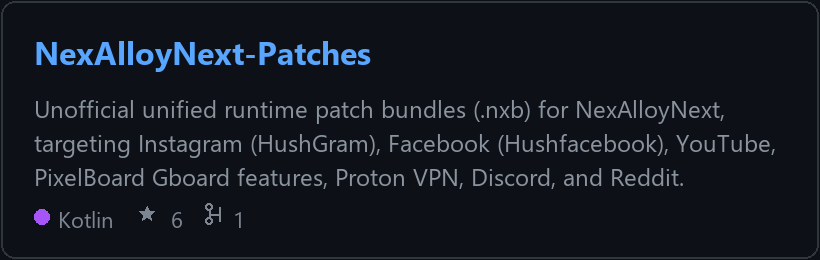
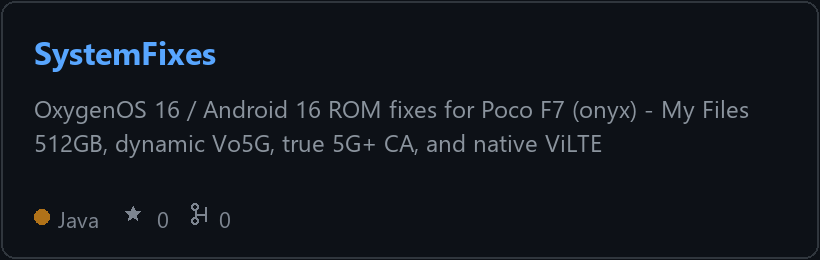
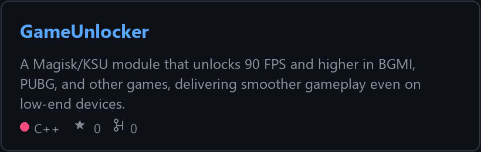
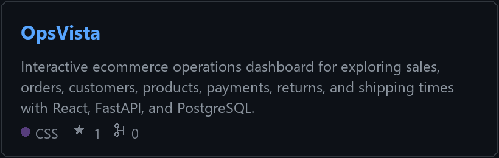
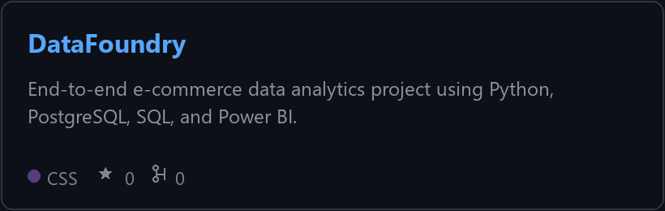
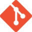
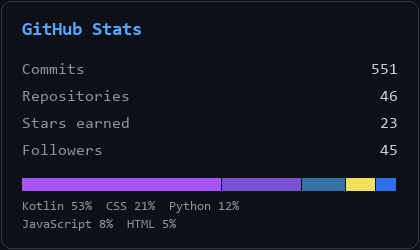

# Hi, I'm Arsalan 👋

<picture>
  <source media="(prefers-color-scheme: dark)" srcset="https://raw.githubusercontent.com/a092devs/profile-assets/main/assets/typing-dark.gif">
  <source media="(prefers-color-scheme: light)" srcset="https://raw.githubusercontent.com/a092devs/profile-assets/main/assets/typing-light.gif">
  
</picture>

 

&nbsp;

&nbsp;

---

I've always wanted to know where a decision actually gets made. In Android that's
usually a layer below the app — a module, a patch, a flag in a config file nobody
documented. On the web it's the database quietly disagreeing with the dashboard built
on top of it. Most of what I do is reading code I didn't write and getting it to behave.

---

### 🌟 Selected work

<table>
  <tr>
    <td width="50%" valign="top">
      <a href="https://github.com/a092devs/NexAlloyNext"><picture>
        <source media="(prefers-color-scheme: dark)" srcset="https://raw.githubusercontent.com/a092devs/profile-assets/main/assets/cards/NexAlloyNext-dark.png">
        <source media="(prefers-color-scheme: light)" srcset="https://raw.githubusercontent.com/a092devs/profile-assets/main/assets/cards/NexAlloyNext-light.png">
        
      </picture></a>
    </td>
    <td width="50%" valign="top">
      <a href="https://github.com/a092devs/NexAlloyNext-Patches"><picture>
        <source media="(prefers-color-scheme: dark)" srcset="https://raw.githubusercontent.com/a092devs/profile-assets/main/assets/cards/NexAlloyNext-Patches-dark.png">
        <source media="(prefers-color-scheme: light)" srcset="https://raw.githubusercontent.com/a092devs/profile-assets/main/assets/cards/NexAlloyNext-Patches-light.png">
        
      </picture></a>
    </td>
  </tr>
  <tr>
    <td width="50%" valign="top">
      <a href="https://github.com/a092devs/SystemFixes"><picture>
        <source media="(prefers-color-scheme: dark)" srcset="https://raw.githubusercontent.com/a092devs/profile-assets/main/assets/cards/SystemFixes-dark.png">
        <source media="(prefers-color-scheme: light)" srcset="https://raw.githubusercontent.com/a092devs/profile-assets/main/assets/cards/SystemFixes-light.png">
        
      </picture></a>
    </td>
    <td width="50%" valign="top">
      <a href="https://github.com/a092devs/GameUnlocker"><picture>
        <source media="(prefers-color-scheme: dark)" srcset="https://raw.githubusercontent.com/a092devs/profile-assets/main/assets/cards/GameUnlocker-dark.png">
        <source media="(prefers-color-scheme: light)" srcset="https://raw.githubusercontent.com/a092devs/profile-assets/main/assets/cards/GameUnlocker-light.png">
        
      </picture></a>
    </td>
  </tr>
  <tr>
    <td width="50%" valign="top">
      <a href="https://github.com/a092devs/OpsVista"><picture>
        <source media="(prefers-color-scheme: dark)" srcset="https://raw.githubusercontent.com/a092devs/profile-assets/main/assets/cards/OpsVista-dark.png">
        <source media="(prefers-color-scheme: light)" srcset="https://raw.githubusercontent.com/a092devs/profile-assets/main/assets/cards/OpsVista-light.png">
        
      </picture></a>
    </td>
    <td width="50%" valign="top">
      <a href="https://github.com/a092devs/DataFoundry"><picture>
        <source media="(prefers-color-scheme: dark)" srcset="https://raw.githubusercontent.com/a092devs/profile-assets/main/assets/cards/DataFoundry-dark.png">
        <source media="(prefers-color-scheme: light)" srcset="https://raw.githubusercontent.com/a092devs/profile-assets/main/assets/cards/DataFoundry-light.png">
        
      </picture></a>
    </td>
  </tr>
</table>

The rest of it lives in the <a href="https://github.com/a092devs?tab=repositories">repository list</a>.

---

### 🛠️ Stack

&nbsp;
&nbsp;
&nbsp;
&nbsp;
&nbsp;
&nbsp;
&nbsp;
&nbsp;
&nbsp;
&nbsp;
&nbsp;
&nbsp;

---

<picture>
  <source media="(prefers-color-scheme: dark)" srcset="https://raw.githubusercontent.com/a092devs/profile-assets/main/assets/stats-dark.png">
  <source media="(prefers-color-scheme: light)" srcset="https://raw.githubusercontent.com/a092devs/profile-assets/main/assets/stats-light.png">
  
</picture>

